# Laboratorium 3 — Room Booking API

**Autor:** Stanisław Kopeć 151894

Node.js, Express 5, Zod, PostgreSQL 16, Knex. Testy wykonano na osobnym schemacie bazy. Obrazy przedstawiają podgląd zapisanych wyników rzeczywistych poleceń `curl.exe`, `psql` i testów.

## Zadanie 1 — baza i migracje

PostgreSQL działa w Dockerze z nazwanym wolumenem. Połączenie jest w `DATABASE_URL`; `.env` jest ignorowany przez Git. Migracje tworzą tabele `buildings`, `rooms` i `reservations`.

```yaml
name: room-booking-lab3

services:
  db:
    image: postgres:16
    environment:
      POSTGRES_USER: ${POSTGRES_USER:?Set POSTGRES_USER in .env}
      POSTGRES_PASSWORD: ${POSTGRES_PASSWORD:?Set POSTGRES_PASSWORD in .env}
      POSTGRES_DB: ${POSTGRES_DB:?Set POSTGRES_DB in .env}
    ports:
      - "127.0.0.1:5433:5432"
    volumes:
      - pgdata:/var/lib/postgresql/data

volumes:
  pgdata:
```

Najważniejsze ograniczenia migracji:

```js
table.string("name", 120).notNullable().unique(); // buildings

// rooms
table.integer("building_id").notNullable()
    .references("id").inTable("buildings").onDelete("RESTRICT");
table.unique(["building_id", "name"]);
table.check("capacity > 0", [], "rooms_capacity_check");

// reservations
table.integer("room_id").notNullable()
    .references("id").inTable("rooms").onDelete("RESTRICT");
table.timestamp("start_time", { useTz: true }).notNullable();
table.timestamp("end_time", { useTz: true }).notNullable();
table.check("end_time > start_time", [], "reservations_time_check");
table.check("status IN ('CONFIRMED', 'CANCELLED')", [], "reservations_status_check");
table.index(["room_id", "start_time", "end_time"], "reservations_overlap_index");
```

`RESTRICT` blokuje usunięcie budynku z salami oraz sali z rezerwacjami, zachowując historię. `down` usuwa tabele w kolejności: rezerwacje, sale, budynki. Cofnięcie i ponowne wykonanie migracji zakończyło się poprawnie.

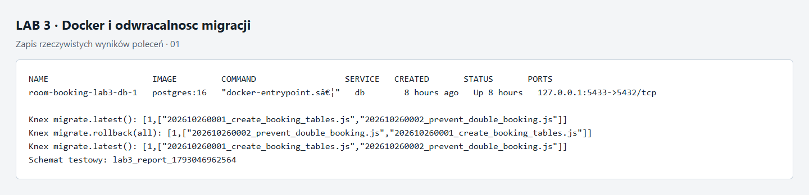

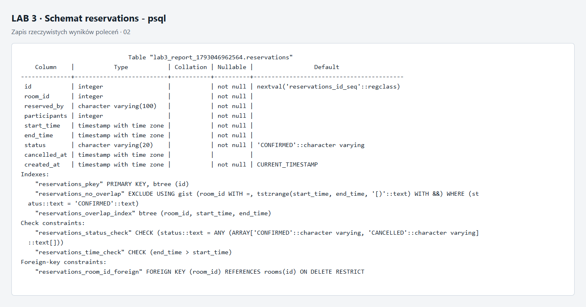

Próby naruszenia UNIQUE, CHECK i FK wykonano przez INSERT w `psql`. Oczekiwane błędy potwierdzają działanie ograniczeń. Dane prób wycofano przez ROLLBACK.

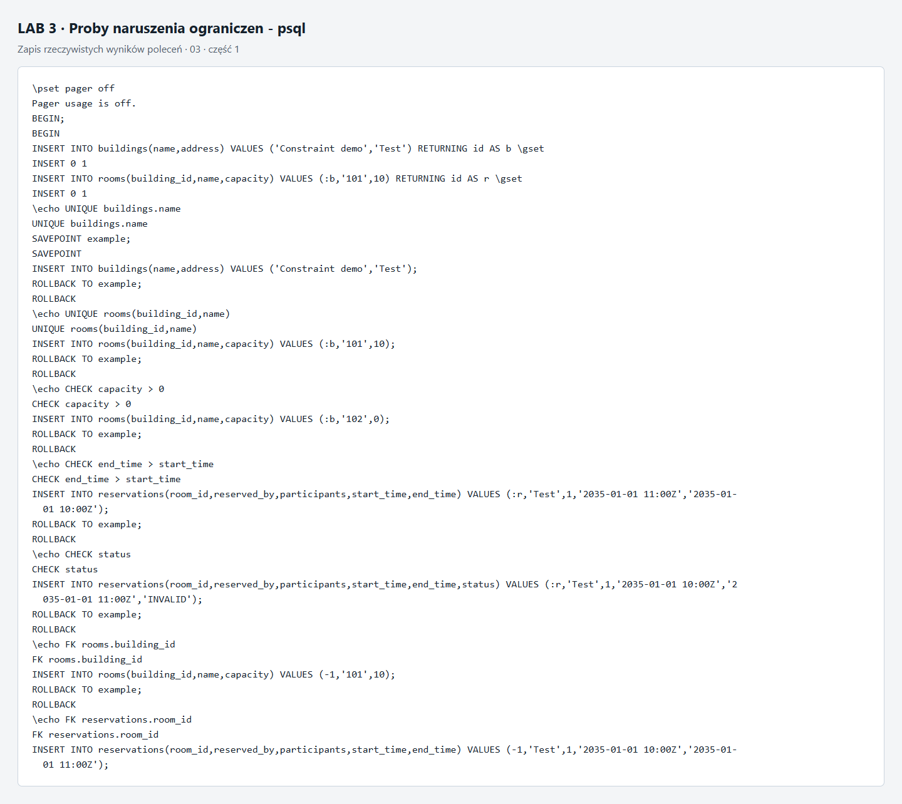

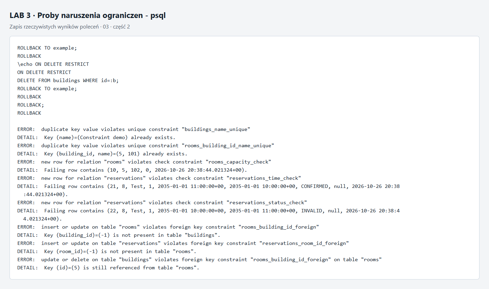

## Zadanie 2 — seedy i repozytoria Knex

Seed tworzy 2 budynki, 5 sal i 5 rezerwacji: jedną anulowaną i jedną rozpoczętą. Powtórne uruchomienie daje identyczne dane i ID od 1.

```js
await trx.raw("TRUNCATE reservations, rooms, buildings RESTART IDENTITY");
```

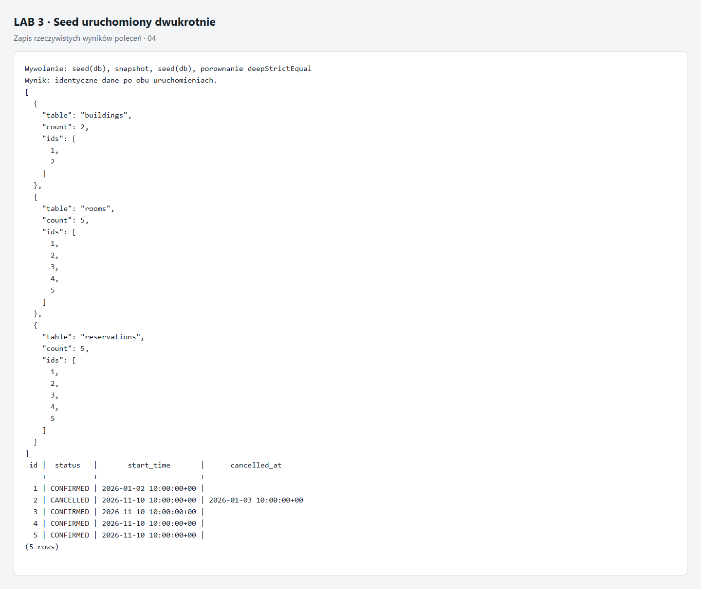

Repozytoria mapują nazwy SQL na camelCase. Wybór Knex odbywa się w `server.js`; repozytoria pamięciowe pozostały w projekcie.

```js
async create({ roomId, reservedBy, participants, startTime, endTime, status }) {
    const [row] = await db("reservations").insert({
        room_id: roomId, reserved_by: reservedBy, participants,
        start_time: startTime, end_time: endTime, status
    }).returning("*");
    return row ? findById(row.id) : null;
}
```

Porównanie service po zadaniu 1 i 2: service rezerwacji bez zmian; service sal otrzymał wyłącznie tworzenie sali i sprawdzenie budynku.

```diff
diff --git a/lab3/src/modules/rooms/rooms.service.js b/lab3/src/modules/rooms/rooms.service.js
index 3b6ccf4..7f538ce 100644
--- a/lab3/src/modules/rooms/rooms.service.js
+++ b/lab3/src/modules/rooms/rooms.service.js
@@ -1,7 +1,12 @@
 const NotFoundError = require("../../errors/NotFoundError");
 
-function createRoomsService({ roomsRepository }) {
+function createRoomsService({ roomsRepository, buildingsRepository }) {
     return {
+        async createRoom(input) {
+            const building = await buildingsRepository.findById(input.buildingId);
+            if (!building) throw new NotFoundError("Building");
+            return roomsRepository.create(input);
+        },
         async listRooms() {
             return roomsRepository.list();
         },
```

Poprawne requesty POST i odczyt tej samej sali po restarcie procesu API:

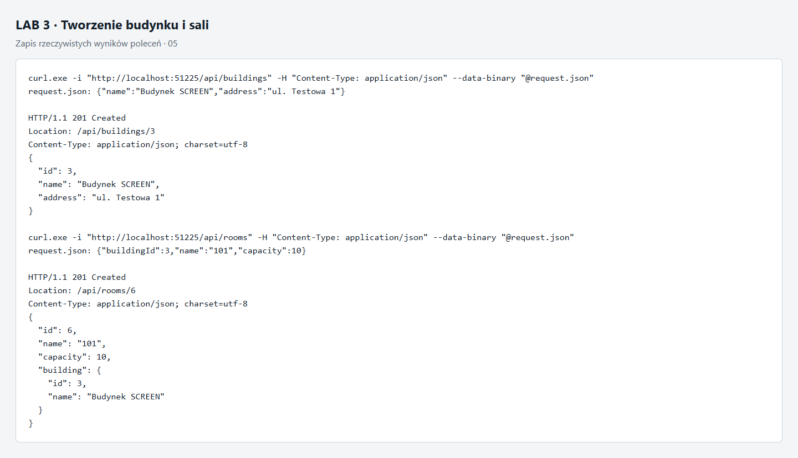

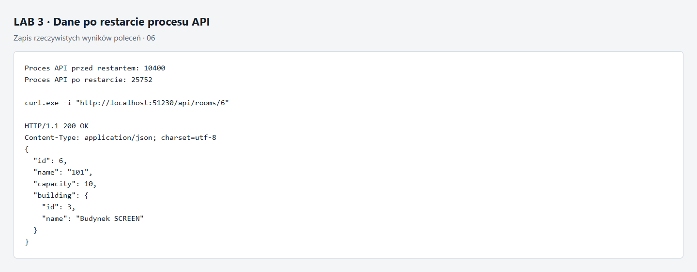

Nieistniejący budynek → `404`. Duplikat nazwy sali w budynku → `409`, bez szczegółów PostgreSQL w odpowiedzi.

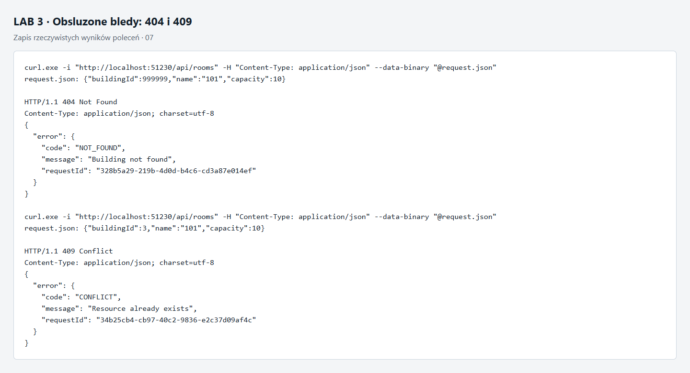

## Zadanie 3 — relacje i JOIN

Odczyt rezerwacji łączy trzy tabele w jednym zapytaniu:

```js
const query = () => db("reservations as res")
    .join("rooms as r", "r.id", "res.room_id")
    .join("buildings as b", "b.id", "r.building_id")
    .select("res.*", "r.name as room_name", "b.id as building_id", "b.name as building_name");
```

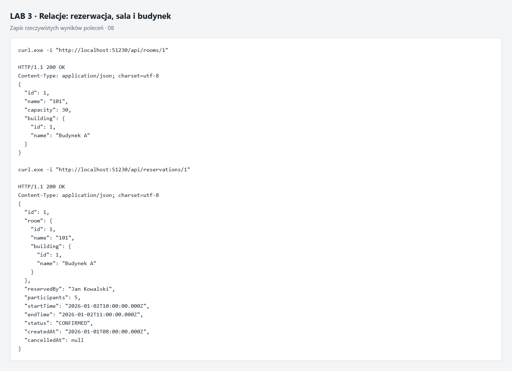

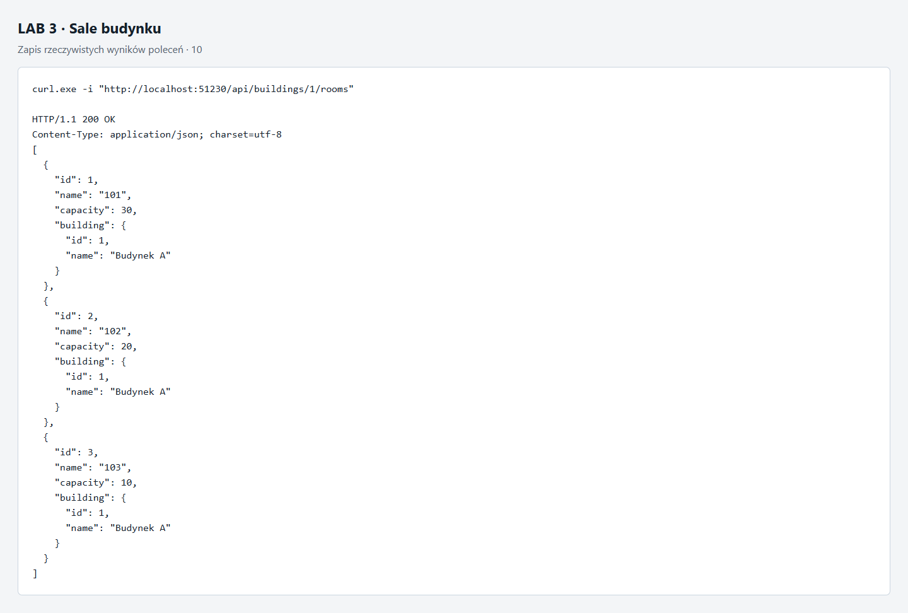

`LEFT JOIN` zachowuje budynki bez sal. `roomsCount` jest liczbą; dla pustego budynku wynosi 0. Lista sal pustego budynku zwraca `[]`, nieistniejącego — `404`.

```js
const rows = await db("buildings as b").leftJoin("rooms as r", "r.building_id", "b.id")
    .select("b.*").count({ rooms_count: "r.id" }).groupBy("b.id").orderBy("b.id");
return rows.map(row => ({ ...toBuilding(row), roomsCount: Number(row.rooms_count) }));
```

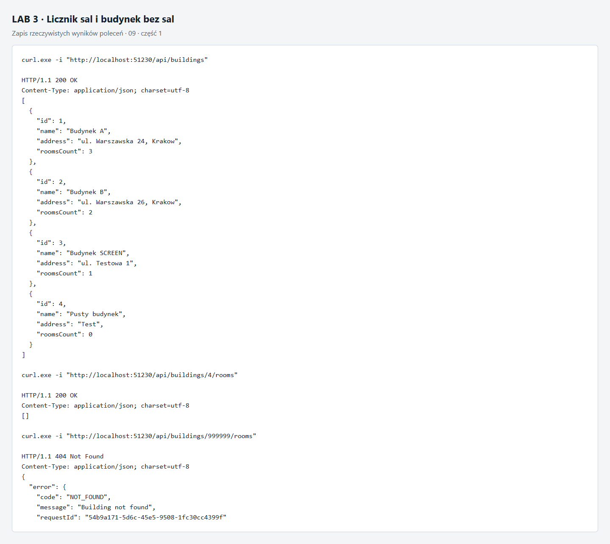

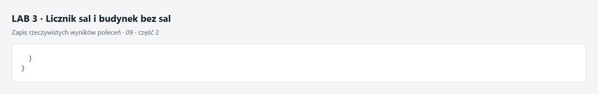

Logi `DEBUG=knex:query`: 5 i 20 rezerwacji dają po 2 zapytania. Finalne API zawiera paginację z zadania 4: jedno zapytanie pobiera dane, drugie liczy wyniki. Brak N+1. Lista sal budynku wykonuje 2 zapytania, szczegóły sali/rezerwacji i lista budynków — po 1.

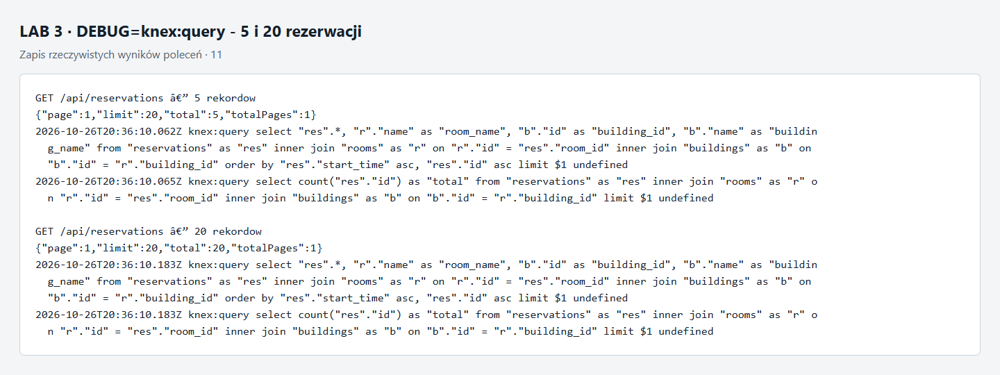

## Zadanie 4 — filtrowanie, paginacja i sortowanie

Filtry, sortowanie i paginację wykonuje SQL. Dozwolone sortowania: `startTime`, `createdAt`, `participants` oraz warianty z `-`. Remisy rozstrzyga `id`. Domyślnie: strona 1, limit 20, sortowanie po `startTime` rosnąco; limit maksymalny 100.

```js
if (roomId !== undefined) base.where("res.room_id", roomId);
if (buildingId !== undefined) base.where("r.building_id", buildingId);
if (status !== undefined) base.where("res.status", status);
if (from !== undefined) base.where("res.end_time", ">", from);
if (to !== undefined) base.where("res.start_time", "<", to);
const descending = sort.startsWith("-");
const column = SORT_COLUMNS[descending ? sort.slice(1) : sort];
const [rows, count] = await Promise.all([
    base.clone().orderBy(column, descending ? "desc" : "asc").orderBy("res.id", "asc")
        .limit(limit).offset((page - 1) * limit),
    base.clone().clearSelect().count({ total: "res.id" }).first()
]);
```

Cztery kombinacje parametrów, odpowiedzi i wygenerowane zapytania SQL:

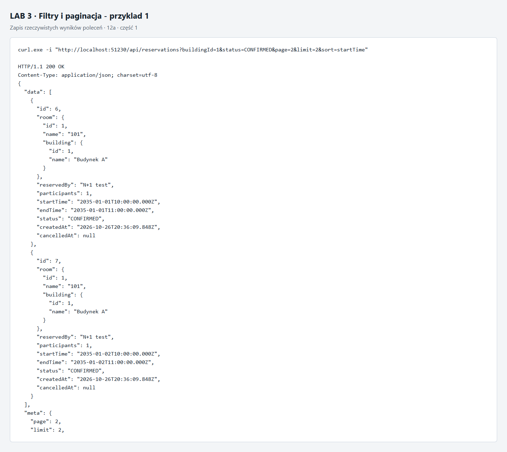

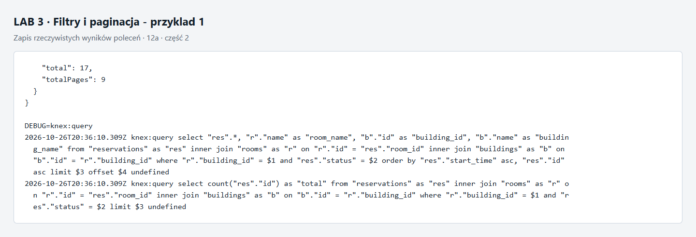

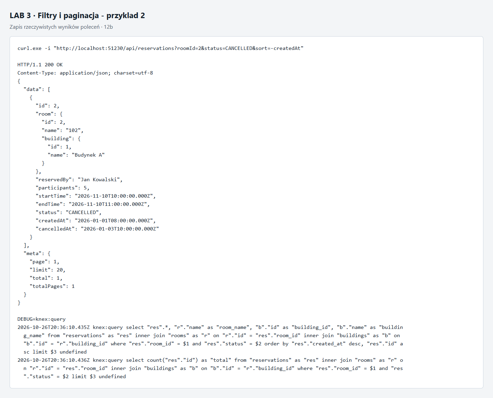

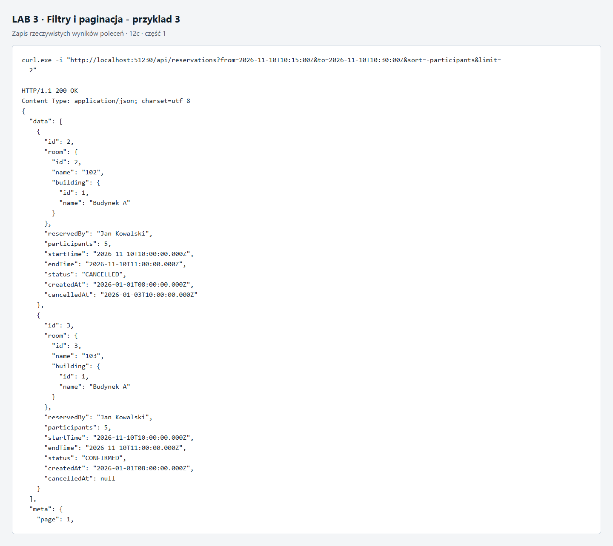

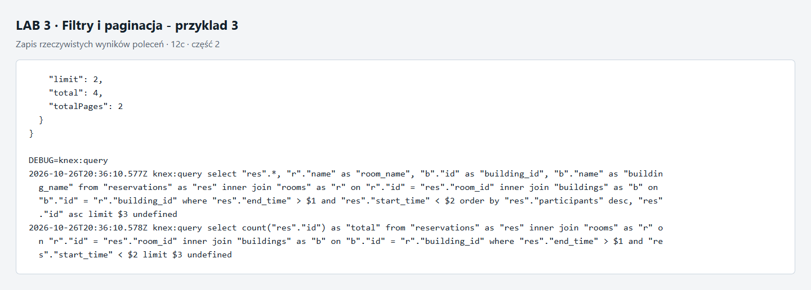

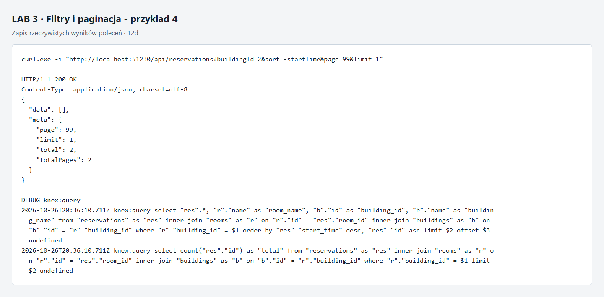

`total` uwzględnia filtry. Strona poza zakresem zwraca `200` i puste `data`. Nieznane sortowanie i `from >= to` zwracają `400`.

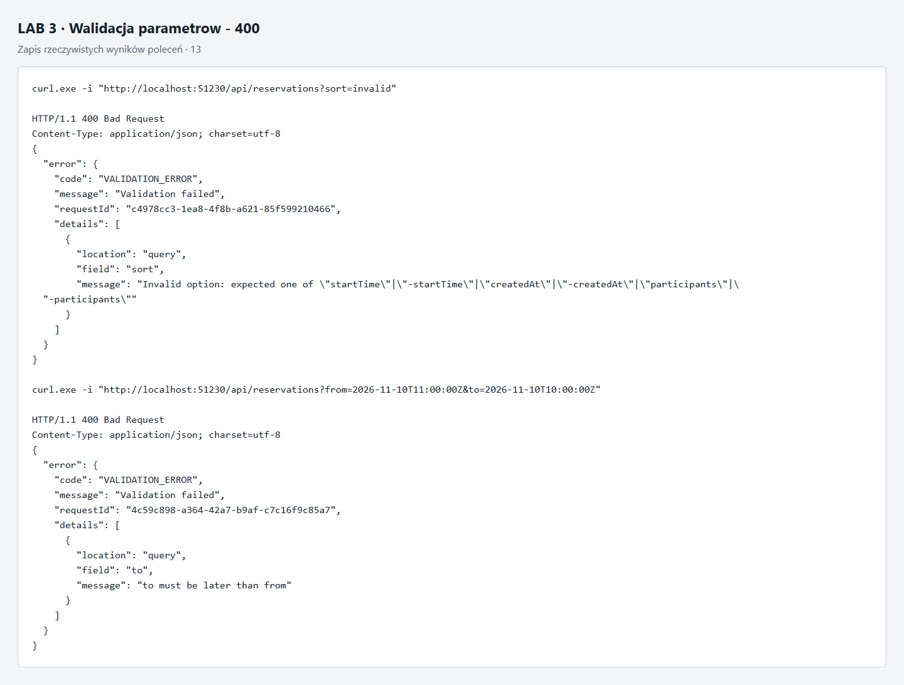

## Zadanie 5 — równoczesne rezerwacje

Sprawdzenie kolizji i zapis są w jednej transakcji. Blokujemy wiersz sali, ponieważ istnieje również wtedy, gdy nie ma jeszcze rezerwacji.

```js
// server.js
runInTransaction: work => db.transaction(trx => work({
    roomsRepository: createRoomsRepository(trx),
    reservationsRepository: createReservationsRepository(trx)
}))

// repository
async lockById(id) {
    await db("rooms").where({ id }).forUpdate().first();
}

// service — wewnątrz runInTransaction
await roomsRepository.lockById(input.roomId);
// walidacja sali i czasu, odczyt rezerwacji i sprawdzenie kolizji
return reservationsRepository.create({ ...input, status: "CONFIRMED" });
```

Dodatkowe zabezpieczenie w nowej migracji:

```js
exports.up = async function (knex) {
    await knex.raw("CREATE EXTENSION IF NOT EXISTS btree_gist WITH SCHEMA public");
    await knex.raw(`ALTER TABLE reservations
        ADD CONSTRAINT reservations_no_overlap
        EXCLUDE USING gist (
            room_id WITH =,
            tstzrange(start_time, end_time, '[)') WITH &&
        ) WHERE (status = 'CONFIRMED')`);
};

exports.down = async function (knex) {
    await knex.raw("ALTER TABLE reservations DROP CONSTRAINT reservations_no_overlap");
    // Keep the shared extension: other tables may also use it.
};
```

Błąd `23P01` jest mapowany na `409 ROOM_ALREADY_BOOKED`.

```js
} else if (error.code === "23P01") {
    statusCode = 409;
    response.code = "ROOM_ALREADY_BOOKED";
    response.message = "Room already booked for this time interval";
}
```

Skrypt `scripts/double-booking.js` wysyła równolegle 10 identycznych POST i liczy zapisane rezerwacje zapytaniem SQL. Test porównuje wariant bez zabezpieczeń, pełne zabezpieczenie oraz sam constraint. Opóźnienie 250 ms występuje tylko w teście demonstracyjnym; API nie zawiera sztucznego opóźnienia.

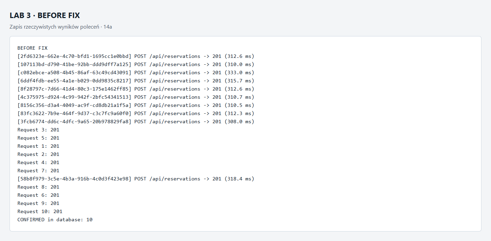

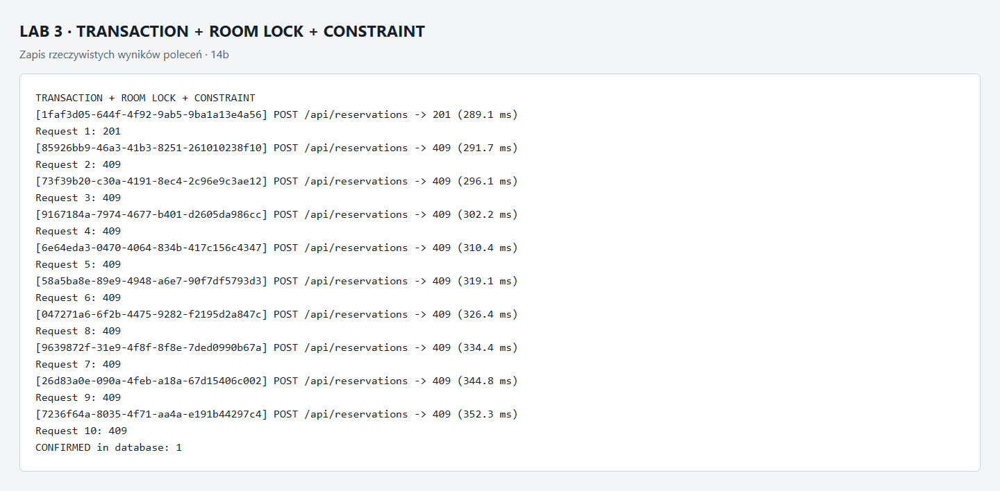

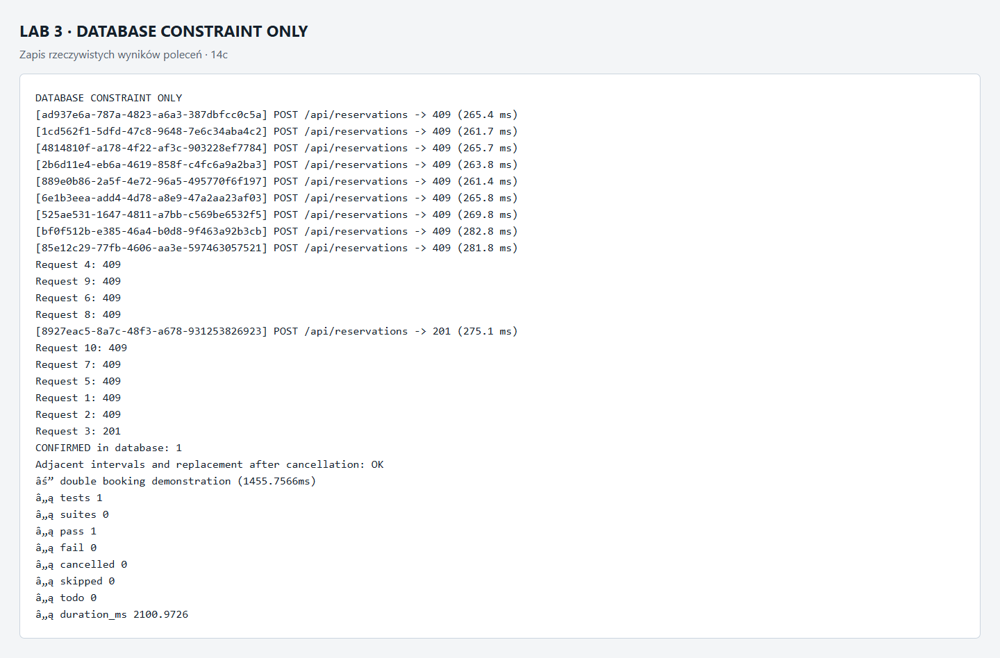

Przed naprawą powstało 10 rezerwacji. Po naprawie i przy samym constraincie: jeden `201`, dziewięć `409`, jedna rezerwacja. Anulowana rezerwacja nie blokuje nowej; stykające się przedziały są dozwolone.

Sama transakcja przy `READ COMMITTED` nie wystarcza: oba requesty mogą odczytać brak kolizji przed zapisem. Blokada sali wymusza kolejność sprawdzeń; constraint niezależnie od aplikacji blokuje nakładające się przedziały.
